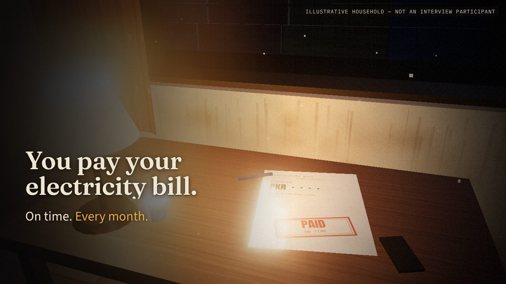
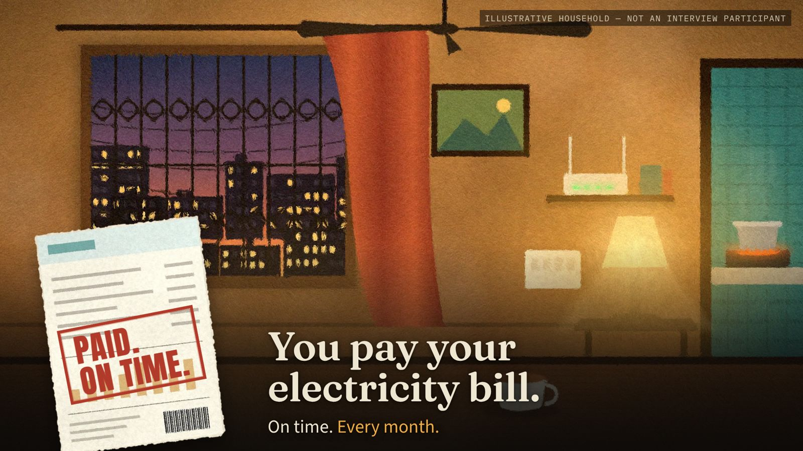

# Paid. On time.
### K-Electric, load-shedding and corporate accountability: a cinematic presentation

KSBL · Business Ethics & Law midterm · Dr Faryal Razzaq
Munhib Alam Khan · Rabie Sami · Abdullah Khan · Karan Kumar

A presenter-controlled, silent documentary presentation (22 scenes, about 10–12 minutes). It is an independent academic analysis, not KE material.

> **Three versions are in this repository. The root `index.html` opens v3.**
> - **`v3/index.html` — live 3D (current).** One real-time WebGL world (three.js) with real lights and a moving camera. It starts inside the room at the paid bill and flies out through the window onto the dark feeder; the committee room, evidence desk, Imad's flat, Gulshan rooftops, a network model and a studio follow. 37 advances, with the same script, qualifications, evidence section and keys. See `docs/V3_NOTES.md`, `docs/SCENE_MANIFEST_V3.md`, `docs/SPEAKER_NOTES_V3.md`, and the stills and recordings in `previews/v3/`. It needs WebGL (any current Chrome or Edge with hardware acceleration on).
> - **`v2/index.html`** — the layered 2.5D motion revision (36 advances).
> - **`v1.html`** — the first version (also on branch `claude/k-electric-cinematic-presentation-pq9921-v1`).

> - **`submission/Paid_On_Time_KE_Ethics.pptx`** — PowerPoint copy for submission: 41 slides (cover, 37 advances, references). Each advance is a frame-exact clip of the live deck that plays automatically and holds on its final frame; script and notes are in the speaker notes; references and the recordings link are clickable. Rebuild: `node tools/v3/clips.mjs <dir> 0 36`, then `node tools/v3/build_pptx.mjs <dir> out.pptx` and `python3 tools/v3/pptx_autoplay.py out.pptx`.





## Launch

Everything is local: fonts, images and code. No internet is needed after cloning.

**Option A: double-click.** Open `index.html` (opens v3), `v2/index.html` or `v1.html` in Chrome or Edge. Everything except the separate presenter window works from `file://`.

**Option B: local server (recommended for the presenter window).**
```bash
cd ke-ethics-midterm
python3 -m http.server 8000      # or: npx serve .
# then open http://localhost:8000
```

Then press **F** for fullscreen. Use a current Chrome or Edge (Firefox works too). The stage is 16:9, scales to any screen and letterboxes on 4:3 projectors.

## Controls

| Key | Action |
|---|---|
| → · Space · Page Down · Enter | Next reveal / scene (clickers work) |
| ← · Page Up | Previous (rebuilds the exact previous state) |
| Home / End | Opening / final scene |
| F | Toggle fullscreen |
| B (or .) | Temporary blackout (any advance key also lifts it) |
| N | Speaker notes: script for this reveal, cues, qualifications, sources |
| O | Scene overview (arrows + Enter to jump) |
| E | References & evidence (clickable full references, interview list, recordings link) |
| M | Low-motion mode (also honours the OS "reduce motion" setting; remembered) |
| P | Presenter window with notes, kept in sync (needs Option B) |
| ? | Key help |
| Esc | Close the open overlay, otherwise exit fullscreen |

Controls stay hidden while presenting. Move the mouse to reveal a small control bar and progress line; they fade after about 2.5 s. Scenes never auto-advance. Transitions finish and then hold. Holding a key down does not race through slides. The final scene holds in silence and further advances do nothing. Press **E** during questions. The address bar keeps your position (e.g. `index.html#12.2`), so a refresh returns to the same reveal.

## Files

```
index.html              entry point
css/style.css           stage, typography, reveal system, overlays
js/manifest.js          SCENE MANIFEST: markup, script passage per reveal, cues, notes, sources, assets
js/references.js        bibliography (exact, from the report), interviews, recordings link
js/app.js               state model (scene + reveal), navigation, overlays, preloading
js/layout.js            positions exported by the art pipeline
assets/img/             painted plates and cutouts (WebP)
assets/fonts/           Fraunces, Anton, Source Sans 3, IBM Plex Mono + OFL licences
docs/SCENE_MANIFEST.md  scene-by-scene table (generated)
docs/SPEAKER_NOTES.md   full script mapped to every advance (generated)
docs/ASSET_REGISTER.md  image/font origins, licences, sources
docs/BUILD_NOTES.md     script ↔ report discrepancies and how they were resolved; testing record
previews/               review screenshots
tools/                  art pipeline and QA scripts (not needed to present)
```

## Editing

**v3:** sets live in `v3/src/world/street.js` and `v3/src/sets/*.js`; camera, light and object choreography plus on-screen text live in `v3/src/deck/scenes.js`; script, notes and sources live in `v3/js/content.js`. Rebuild with `cd v3 && npm install && npm run build` (writes `v3/dist/deck.js`, committed so no build is needed to present). Regenerate v3 docs with `node tools/v3/export_docs.mjs`. QA: `node tools/v3/test_controls.mjs`, `node tools/v3/stills.mjs /tmp/v3 all`, `node tools/v3/record.mjs out.mp4 1.1 4`. If a laptop stutters, press **M** (low motion) or open `v3/index.html?q=0`.


**v2:** worlds (layers and depths) live in `v2/js/worlds.js` and `worlds_b.js`; scene choreography (camera, per-layer timing and paths, UI text and anchors) lives in `v2/js/scenes_a.js` … `scenes_d.js`; script, notes and sources live in `v2/js/content.js`. Regenerate v2 docs with `node tools/v2/export_docs.mjs`.

**v1:** scene text, notes and cues live in `js/manifest.js`. After editing, regenerate the docs with `node tools/export_docs.mjs`. Images are rebuilt from source with `tools/build_art.sh` (Python 3 with numpy and Pillow, plus Node with Playwright).

QA:
```bash
node tools/v2/test_controls.mjs                # v2: 36 functional checks + frame pacing
node tools/v2/record.mjs out.webm "#1.1" "W2500,R,W4800,R,W7200"   # record a motion preview
node tools/v2/stills.mjs /tmp/v2 all           # screenshot every v2 reveal after it settles
python3 tools/v2/build.py home press imad gulshan ops rest   # rebuild all v2 layers
node tools/test_controls.mjs                   # v1: 36 functional checks
node tools/shoot.mjs /tmp/shots 1920 1080      # screenshot every reveal
node tools/shoot.mjs /tmp/shots 1366 768 --lowmo
```

## Before presenting
- Rehearse once on the classroom laptop and projector. If motion stutters, press **M**.
- The interview recordings link (evidence section) is for the instructor. Do not open it during the talk.
- Check `docs/BUILD_NOTES.md` item 3: the report's "K-Electric, 2026s" citation needs correcting.
